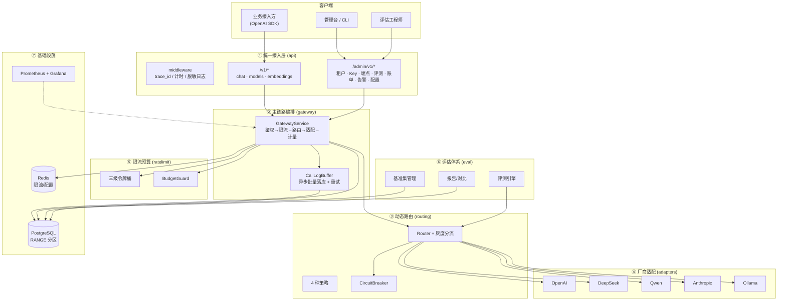

# LLM Unified Platform

> 企业级大模型统一接入与能力评估中台 — 多厂商适配、动态路由、限流预算、评估体系、灰度容灾、可观测账单。

[](../../actions)
[](LICENSE)
[](https://www.python.org/downloads/)

---

## 项目定位

为企业提供统一的大模型接入网关与能力评估平台，屏蔽厂商差异，实现：

- **多厂商适配**：OpenAI / DeepSeek / Qwen / Anthropic / Ollama 统一协议（ADR-001）
- **动态路由**：成本优先 / 延迟优先 / 加权轮询 / 健康感知，熔断自动切换
- **限流与预算**：租户/Key/模型三级令牌桶，月度预算 80%/100% 熔断
- **评估体系**：版本化基准集（200+ 样本）、多维指标、多模型对比、防篡改 checksum
- **灰度容灾**：配置热更新 ≤5s、灰度分流（租户/Key 白名单）、1 分钟回滚
- **可观测账单**：Prometheus 全量指标、Grafana 看板、账单 CSV/JSON 导出

## 架构图



## 快速上手

### 方式一：Docker Compose（推荐）

```bash
# 1. 克隆仓库
git clone <repo-url> && cd llm-unified-platform

# 2. 配置环境变量
cp .env.example .env
# 编辑 .env 填入真实 API Key 和 JWT Secret

# 3. 起栈（PostgreSQL + Redis + 应用）
docker compose -f deploy/docker-compose.yml up -d

# 4. 执行数据库迁移
docker compose -f deploy/docker-compose.yml exec app alembic upgrade head

# 5. 验证
curl http://localhost:8000/healthz
# 预期输出: {"status":"ok"}
```

### 方式二：venv 本地开发

```bash
# 1. 创建虚拟环境
python -m venv .venv && source .venv/bin/activate  # Windows: .venv\Scripts\activate

# 2. 安装依赖
pip install -e ".[dev]"

# 3. 启动 PostgreSQL 和 Redis（或 docker compose -f deploy/docker-compose.yml up -d postgres redis）

# 4. 配置环境变量
cp .env.example .env

# 5. 执行迁移
alembic upgrade head

# 6. 启动服务
uvicorn llm_platform.main:app --reload --port 8000
```

### 一键演示

需先启动服务（方式一或方式二），然后执行：

```bash
bash scripts/demo_quickstart.sh
```

自动完成：检查服务→seed 租户/Key/端点→加载 200 条基准集→发起 chat 请求→跑评测→导出账单。

## 配置说明

所有配置通过 `LLM_` 前缀环境变量注入，完整列表见 [.env.example](.env.example)：

| 变量 | 默认值 | 说明 |
|------|--------|------|
| `LLM_ENVIRONMENT` | `dev` | 运行环境（dev/staging/prod） |
| `LLM_DATABASE_URL` | `sqlite:///./llm_platform.db` | 数据库连接串（默认 SQLite，生产用 PostgreSQL） |
| `LLM_REDIS_URL` | `redis://localhost:6379/0` | Redis 连接串 |
| `LLM_JWT_SECRET` | *(必填)* | JWT 签名密钥（生产必须替换） |
| `LLM_JWT_EXPIRE_MINUTES` | `60` | JWT 过期时间（分钟） |
| `LLM_OPENAI_API_KEY` | *(空)* | OpenAI API Key |
| `LLM_DEEPSEEK_API_KEY` | *(空)* | DeepSeek API Key |
| `LLM_QWEN_API_KEY` | *(空)* | 通义千问 API Key |
| `LLM_ANTHROPIC_API_KEY` | *(空)* | Anthropic API Key |
| `LLM_OLLAMA_BASE_URL` | `http://localhost:11434` | Ollama 服务地址 |
| `LLM_REQUEST_TIMEOUT_S` | `60` | 上游请求超时（秒） |
| `LLM_RATE_LIMIT_DEFAULT_RPM` | `60` | 默认每分钟请求数 |
| `LLM_RATE_LIMIT_DEFAULT_TPM` | `60000` | 默认每分钟 Token 数 |
| `LLM_DEFAULT_MONTHLY_BUDGET` | `1000.0` | 默认月度预算（USD） |
| `LLM_BUDGET_ALERT_RATIO` | `0.8` | 预算告警阈值 |
| `LLM_ROUTING_STRATEGY` | `health_aware` | 路由策略 |

## API 文档摘要

### 业务面（OpenAI 兼容）

| 方法 | 路径 | 说明 |
|------|------|------|
| `POST` | `/v1/chat/completions` | Chat 补全（支持流式 SSE） |
| `GET` | `/v1/models` | 可用模型列表 |
| `POST` | `/v1/embeddings` | 文本向量化 |

```bash
curl -X POST http://localhost:8000/v1/chat/completions \
  -H "Authorization: Bearer sk-your-key" \
  -H "Content-Type: application/json" \
  -d '{"model":"gpt-4o","messages":[{"role":"user","content":"hello"}]}'
```

### 管理面

| 方法 | 路径 | 说明 |
|------|------|------|
| `POST` | `/admin/v1/auth/token` | API Key → JWT |
| `POST/GET` | `/admin/v1/tenants` | 租户管理 |
| `POST/GET` | `/admin/v1/api-keys` | API Key 管理 |
| `POST/GET` | `/admin/v1/endpoints` | 模型端点管理 |
| `GET` | `/admin/v1/calls` | 调用日志查询 |
| `POST/GET` | `/admin/v1/eval-datasets` | 基准集管理 |
| `POST/GET` | `/admin/v1/eval-tasks` | 评测任务管理 |
| `GET` | `/admin/v1/billing/summary` | 账单汇总 |
| `GET` | `/admin/v1/billing/export` | 账单导出（CSV/JSON） |
| `GET` | `/admin/v1/alerts` | 告警列表 |
| `GET/PUT` | `/admin/v1/config/{namespace}` | 配置管理 |
| `POST` | `/admin/v1/mcp/tools` | MCP 工具注册 |

完整接口契约见 [docs/api-contract.md](docs/api-contract.md)，交互式文档启动后访问 `/docs`（Swagger UI）。

## 测试与验证

```bash
# 全量测试（243+ 用例）
python -m pytest tests/ -q

# 代码检查
ruff check src/ tests/

# Docker Compose 配置校验
docker compose -f deploy/docker-compose.yml config -q

# 密钥扫描（CI 自动执行）
gitleaks detect --source .
```

## 目录结构

```
llm-unified-platform/
├── src/llm_platform/
│   ├── api/                # HTTP 路由层（v1 业务面 + admin 管理面）
│   ├── auth/               # JWT / API Key / 审计
│   ├── adapters/           # 厂商适配器（OpenAI/DeepSeek/Qwen/Anthropic/Ollama）
│   ├── routing/            # 动态路由 + 熔断
│   ├── ratelimit/          # 三级令牌桶 + 预算守卫
│   ├── gateway/            # 主链路编排 + call_log 缓冲
│   ├── eval/               # 评估体系（基准集/指标/报告/MCP）
│   ├── scheduler/          # 评测任务队列 + Worker
│   ├── config_center/      # 配置版本 + 热更新
│   ├── monitoring/         # Prometheus 指标 + 账单 + 告警
│   ├── db/                 # SQLAlchemy 2.0 + Alembic
│   └── models/             # 实体 + DTO
├── tests/                  # 单元 + 集成测试
├── docs/                   # 架构/API/运维文档
├── deploy/                 # Prometheus 告警 + Grafana 看板
├── scripts/                # 演练脚本 + 数据种子
└── migrations/             # Alembic 迁移
```

## 文档索引

| 文档 | 说明 |
|------|------|
| [docs/PRD.md](docs/PRD.md) | 产品需求文档 |
| [docs/architecture.md](docs/architecture.md) | 架构设计（分层/类图/序列图） |
| [docs/api-contract.md](docs/api-contract.md) | API 接口契约 |
| [docs/data-model.md](docs/data-model.md) | 数据模型设计 |
| [docs/deployment.md](docs/deployment.md) | 部署方案 |
| [docs/operations.md](docs/operations.md) | 运维手册 |
| [docs/stage-1-report.md](docs/stage-1-report.md) | 阶段一交付报告 |
| [docs/stage-2-report.md](docs/stage-2-report.md) | 阶段二交付报告 |
| [docs/stage-3-report.md](docs/stage-3-report.md) | 阶段三交付报告 |
| [docs/stage-4-report.md](docs/stage-4-report.md) | 阶段四交付报告 |
| [docs/qa-stage1-round1.md](docs/qa-stage1-round1.md) | QA 阶段一测试报告 |
| [docs/qa-stage2-round1.md](docs/qa-stage2-round1.md) | QA 阶段二第 1 轮 |
| [docs/qa-stage2-round2.md](docs/qa-stage2-round2.md) | QA 阶段二第 2 轮 |
| [docs/qa-stage3-round1.md](docs/qa-stage3-round1.md) | QA 阶段三第 1 轮 |
| [docs/qa-stage3-round2.md](docs/qa-stage3-round2.md) | QA 阶段三第 2 轮 |

## License

[MIT](LICENSE)

## 免责声明

- 本项目内置的 200 条评测样本为**模板生成的演示数据**，不包含任何真实用户数据或商业数据。
- 各大模型厂商的 API Key 请通过环境变量注入，切勿硬编码或提交到仓库。
- 本项目仅供学习与内部评估使用，生产部署前请完成安全审计与压测。
