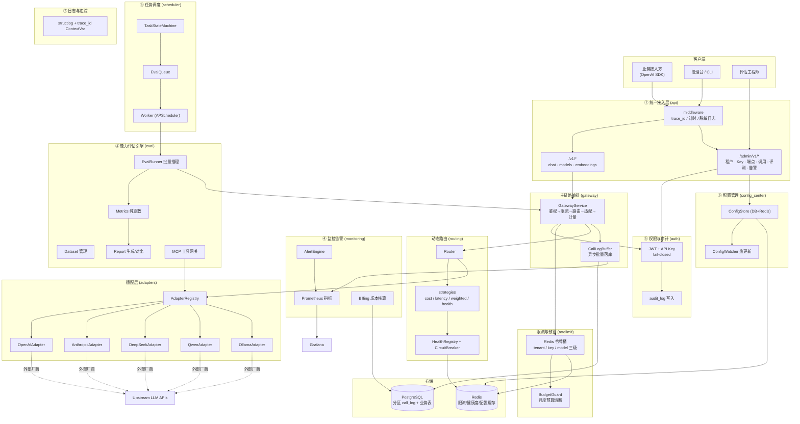
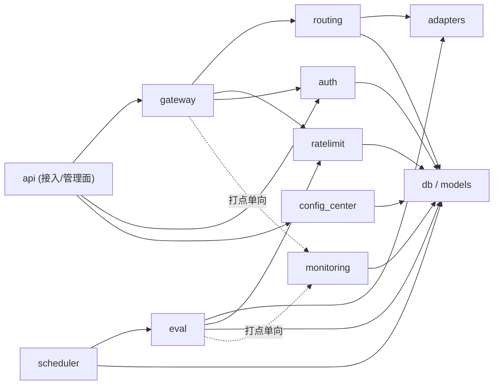
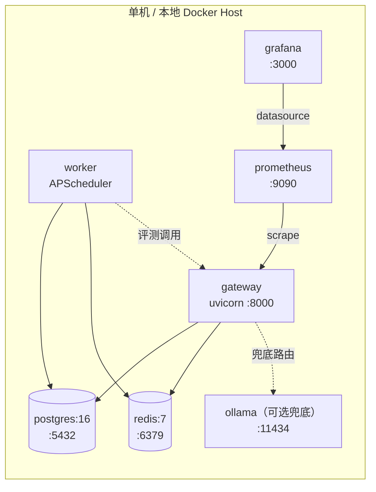

# 架构设计文档 — 大模型统一接入与能力评估中台

| 项 | 内容 |
| --- | --- |
| 文档版本 | v1.0 |
| 需求真源 | `docs/PRD.md`（P0-01~P0-08 / P1-01~P1-13 / P2-01~P2-06） |
| 技术基线 | FastAPI + PostgreSQL + Redis + Prometheus/Grafana + Alembic + structlog |
| 部署形态 | 本地 Docker Compose（可平移单机服务器） |
| 代码基线 | 既有脚手架 22 文件（六表迁移 + 适配器抽象 + 配置/日志/错误码） |

---

## 1. 总体架构

### 1.1 分层架构图

### 1.2 七模块职责与交互边界

| # | 模块 | 代码包 | 核心职责 | 依赖（上游） | 输出（下游） | 明确不做什么 |
| --- | --- | --- | --- | --- | --- | --- |
| ① | 统一接入层 | `api/`, `gateway/` | OpenAI 兼容协议、请求/响应标准化、SSE 流式转发、request_id 生成、主链路编排 | auth, ratelimit, routing, adapters, gateway/buffer | call_log、Prometheus 指标 | 不做路由决策；不感知厂商差异；不做业务聚合逻辑 |
| ② | 能力评估引擎 | `eval/` | 基准集管理、批量推理、指标计算、报告/对比、MCP 工具接入 | scheduler, adapters, ratelimit(独立桶) | eval_task / eval_report、告警事件 | 不直接对外提供在线推理 API；不共用在线限流桶 |
| ③ | 任务调度 | `scheduler/` | 评测任务队列、并发控制、失败重试、任务状态机 | config_center, eval | eval 执行、监控事件 | 不参与在线推理；不做 cron 以外的业务调度 |
| ④ | 监控告警 | `monitoring/` | Prometheus 指标、告警规则、成本核算与账单 | 各模块打点（pull/push 单向）、call_log 读 | Grafana 看板、告警、账单明细 | 不阻塞主链路；不存调用明细（明细在 call_log）；不反向控制业务 |
| ⑤ | 权限与审计 | `auth/` | JWT/API Key 鉴权、租户/项目/Key 配额上下文、操作审计 | db（api_key/tenant/audit_log）、config_center | 鉴权上下文、audit_log | 鉴权失败立即拒绝（fail-closed）；不参与路由；不读 Prompt 明文 |
| ⑥ | 配置管理 | `config_center/` | 模型池/路由/限流/灰度配置、热更新、版本与变更记录 | db, Redis pub/sub | 各模块配置订阅 | 禁止模块私自读文件绕过配置中心；变更必须有生效回执 |
| ⑦ | 日志与追踪 | `logging.py`, `utils/` | 结构化日志、trace_id 全链路、脱敏、链路聚合 | 全模块（横切） | stdout/文件 → 日志存储 | 不参与业务逻辑；不记录敏感明文；采样率可配 |

### 1.3 依赖方向规则（强制）

**依赖铁律**：

1. **严格单向**：`api → gateway → routing → adapters`；`scheduler → eval → adapters`；底层模块（`db`/`models`/`logging`/`errors`/`config_center`）不得 import 任何上层模块。
2. **禁止循环依赖**：`adapters` 不得依赖 `gateway`/`api`；`monitoring` 不得回调业务链路（只被打点/只读库）。
3. **横切只下沉**：`auth`、`logging`、`monitoring` 作为横切关注点，只能被上层调用，不得反向编排业务。
4. **模块间只经接口交互**：适配器只暴露 `BaseAdapter` 抽象；路由策略只暴露 `RouteStrategy` 协议；配置消费方只经 `ConfigWatcher` 订阅回调。
5. **评测隔离**：`eval` 复用 `adapters`，但使用 `eval:` 前缀独立限流桶与独立并发配额，禁止抢占在线流量。

---

## 2. 技术选型表

| 领域 | 选型 | 版本基线 | 选择理由 | 备选方案（未采用原因） |
| --- | --- | --- | --- | --- |
| Web 框架 | FastAPI + uvicorn | fastapi≥0.115 | 原生 async、OpenAPI 自动产出、依赖注入适合鉴权/限流挂载 | Django Ninja（生态弱）、aiohttp（无 schema 校验） |
| 数据校验 | Pydantic v2 | ≥2.8 | 请求/响应 schema 即文档；与 FastAPI 同源；性能优 | dataclasses（缺校验/序列化） |
| ORM | SQLAlchemy 2.0 | ≥2.0 | `Mapped` 类型化 ORM、批量写入、Alembic 原生配合 | Tortoise（迁移生态弱） |
| 迁移 | Alembic | ≥1.13 | 可重复执行/回滚；CI 可校验 | 手写 SQL（不可维护） |
| 主库 | PostgreSQL 16 | 16.x | 声明式分区（call_log 按月）、JSONB、部分索引 | MySQL（分区/JSON 能力弱）、SQLite（无并发写） |
| 缓存/限流 | Redis 7 | 7.x | Lua 令牌桶原子扣减、pub/sub 配置广播、轻量 KV | Memcached（无原子脚本）、内存计数（多进程失效） |
| HTTP 客户端 | httpx | ≥0.27 | 原生 async、流式 SSE、连接池复用 | requests（阻塞）、aiohttp（API 繁琐） |
| 日志 | structlog | ≥24.1 | 结构化 JSON、ContextVar 透传 trace_id | loguru（缺 contextvar 集成）、标准库（无结构化） |
| 指标 | prometheus-client | ≥0.20 | 事实标准、Grafana 直连 | statsd（需额外代理） |
| 任务调度 | APScheduler | ≥3.10 | 进程内异步调度、失败重试可控；作品集规模无需 Celery | Celery（运维重）、RQ（功能少） |
| JWT | PyJWT | ≥2.9 | 轻量、三档角色 claim 足够 | python-jose（维护停滞） |
| 密钥哈希 | argon2-cffi（辅以 hashlib.sha256） | 新增依赖 | API Key 高熵随机串用 SHA-256 即可校验；用户口令类用 argon2 | bcrypt（许可/性能） |
| 评测指标 | 自建纯函数 + 可选 rouge-score / bert-score | P1 阶段 | 指标可离线重算、版本化；重依赖（bert-score 拉 torch）做成 optional extra | RAGAS 全量（依赖过重，P2 增强再引入） |
| MCP 工具 | mcp-python-sdk | ≥1.0 | PRD 指定标准 | 自定义工具协议（不兼容） |
| 容器 | Docker + Docker Compose | v2 | 一键部署、可平移单机 | K8s（规模不符） |
| CI | GitHub Actions | — | 免费、开源仓库原生集成 | Jenkins（运维成本） |
| 代码质量 | ruff + mypy + gitleaks | ruff≥0.5 | lint/format/类型/密钥扫描四合一门槛 | flake8+black+isort（碎片化） |

---

## 3. 关键设计决策（ADR）

### ADR-001 协议归一化策略
- **决策**：内部定义 `ChatRequest / ChatMessage / ChatChoice / Usage / ChatResponse`（`adapters/base.py`），所有厂商协议在适配器内双向翻译；对外只暴露 OpenAI Chat Completions 形状（含 SSE delta 约定）。
- **理由**：业务侧零改造（OpenAI SDK 直连）；厂商协议变更只改单个适配器；`Usage` 统一计量口径。
- **备选**：① 直接透传各厂商协议 —— 否决（绑定厂商，违背"一次接入多模型"）；② 全量引入 LiteLLM —— 否决（黑盒重、不可控，作品集需可讲解可掌控）。
- **后果**：新增厂商 = 新增一个 `BaseAdapter` 子类 + 注册；不改核心链路。

### ADR-002 路由与 failover
- **决策**：`Router` 按策略从模型池（`model_endpoint`）选路，策略可配：`cost_first` / `latency_first` / `weighted_round_robin` / `health_aware`。失败按两类处理：可重试（超时/5xx/连接错误）→ 按候选优先级 failover 至下一 endpoint；不可重试（4xx 校验/鉴权）→ 直接返回错误。健康度由滑动窗口（错误率 + 延迟 EWMA）维护，存 Redis；熔断器三态 `closed → open → half_open`，open 持续 30s 后半开探测，成功则闭合。
- **理由**：满足"单厂商故障 30s 内自动 failover、熔断半开 30s 探测"；策略热更新可配。
- **备选**：纯加权轮询 —— 否决（无成本/延迟感知）；集中式代理（Envoy）—— 否决（超出作品集规模）。
- **后果**：failover 端到端 P95 影响 ≤ 200ms（仅重试一次 + 候选预热连接）。

### ADR-003 限流熔断与预算管控
- **决策**：Redis Lua 令牌桶三级限流（tenant / api_key / model），RPM + TPM 双维度，误差 ≤ 5%（Lua 原子扣减）；月度预算在 Redis 累计 `cost`（`budget:{tenant}:{YYYYMM}`），≥80% 触发黄色告警，≥100% 返回 `QUOTA_002` 并熔断当月新请求。评测流量走 `eval:` 前缀独立桶，与在线桶物理隔离。
- **理由**：多进程/多实例下内存计数不可靠；预算是"硬限流"需求；评测不抢占在线流量是 PRD 明确边界。
- **备选**：数据库计数（延迟高）、进程内限流（多 worker 失效）。
- **后果**：Redis 不可用时限流降级为"放行 + 告警"（fail-open for rate-limit only），鉴权仍 fail-closed。

### ADR-004 鉴权与审计
- **决策**：双轨鉴权——① 业务面 `/v1/*` 用 **API Key**（`Authorization: Bearer sk-...`），库中只存 `key_hash`（SHA-256），明文仅创建时一次性返回；② 管理面 `/admin/v1/*` 用 **JWT**（三档角色 `admin` / `consumer` / `evaluator`，由管理员 API Key 换取）。鉴权失败一律 401（fail-closed）。所有管理操作与调用完成事件写 `audit_log`；审计只记 Prompt 长度 + hash，不记明文。
- **理由**：PRD 红线（fail-closed、仅存 hash、跨租户不可见）；三档角色覆盖全部用户故事，SSO 留扩展点。
- **备选**：仅 JWT（业务侧接入重）、仅 API Key（管理面无角色）。
- **后果**：`AuthService` 为唯一鉴权入口，任何新路由必须挂载鉴权依赖。

### ADR-005 评估引擎解耦
- **决策**：`eval` 包只依赖 `adapters` 抽象与 `scheduler` 提供的执行接口；指标计算为**纯函数**（输入样本 + 模型输出 → 指标值），支持离线重算；报告 JSON 落库（`eval_report`），PNG 由服务端 matplotlib 渲染导出；基准集版本化（`eval_dataset.version` + `checksum`）。
- **理由**：评测不阻塞在线主链路；结果可复现（波动 ≤ 2%）；指标升级只换 `evaluator_version` 不影响历史数据。
- **备选**：评测与网关同进程同步执行 —— 否决（阻塞主链路，违反 NFR 6.1）。

### ADR-006 call_log 百万级写入与查询
- **决策**：
  - **写入**：请求完成后写入内存 `asyncio.Queue`，后台协程批量 flush（每 500 条或 1s 触发，`executemany`）；进程退出前 drain；flush 失败落本地 SQLite 缓冲文件重试。
  - **分区**：`call_log` 按 `created_at` **RANGE 月分区**；维护脚本预建未来 3 个月分区。
  - **索引**：`(tenant_id, created_at DESC)`、`(project_id, created_at DESC)`、`(trace_id)`、`(model, created_at DESC)`、`(endpoint_id, created_at DESC)`、`(status, created_at DESC)`（非 ok 部分索引）。
  - **归档**：T-90 天分区 `DETACH` 后导出 Parquet/CSV 至归档卷，再 DROP。
- **理由**：满足"百万级 call_log 查询 P95 ≤ 3s、千万级 Token 计量可扩展、异步批量写入不阻塞主链路"。
- **备选**：同步单条 INSERT（拖慢 P95）、按年分区（分区过大）、ES 存明细（运维重）。

### ADR-007 缓存设计
- **决策**：Redis 三类用途，**禁止缓存 Prompt/响应内容**：
  | 用途 | Key 形态 | TTL | 失效策略 |
  | --- | --- | --- | --- |
  | 限流计数 | `rl:{tenant\|key\|model}:{window}` | 窗口长度 | 自然过期 |
  | 预算累计 | `budget:{tenant}:{YYYYMM}` | 月度 | 月初重建 |
  | 路由健康度/熔断态 | `health:{endpoint_id}` / `cb:{endpoint_id}` | 30s | 探测刷新 |
  | API Key 鉴权缓存 | `akcache:{key_hash}` | 60s | 吊销时主动 DEL |
  | 配置缓存 | `cfg:{namespace}` + `cfg:ver` | 60s | 版本号变更失效 |
- **理由**：QPS~100 下鉴权/配置查询压力大；60s 缓存 + 主动失效兼顾实时与吞吐。
- **备选**：进程内 LRU（多 worker 不一致）。

### ADR-008 灰度发布
- **决策**：`config_revision` 表存灰度规则（`subject_type: tenant|api_key|model`，`weight 0-100`，`canary_group: stable|canary`）；路由选择时按权重决定流量落 stable 还是 canary endpoint 组；配置变更经 Redis pub/sub 广播 + 版本号轮询兜底，**5s 内生效**；一键回滚 = 将 canary 权重置 0（≤1 分钟）。
- **理由**：满足 P1-09（按租户/Key/模型粒度灰度、5s 生效、1 分钟回滚）；规则与模型池同存配置中心，避免双源。

### ADR-009 密钥管理
- **决策**：所有密钥（厂商 Key / JWT Secret / DB 密码）**只经环境变量或 Docker secret 注入**，代码只读 `Settings`（`LLM_` 前缀）；`model_endpoint` 不存厂商明文 Key，只存 `credential_env`（环境变量名，如 `LLM_OPENAI_API_KEY`），运行时按名取值；`.env.example` 仅占位符；**gitleaks 零告警为 PR 合并硬门槛**（CI 步骤）。
- **理由**：PRD §6.3 红线；`credential_env` 使"多租户多厂商密钥"不入库、可轮换。
- **备选**：密钥加密入库 —— 否决（仍有泄露面，且违反"零硬编码/secret 注入"口径）。

### ADR-010 MCP 工具网关（P1-05）
- **决策**：`eval/mcp_gateway.py` 基于 `mcp-python-sdk` 实现工具注册（`mcp_tool` 表）与调用代理；工具调用的成功率/延迟以 `source="mcp"` 写入 `call_log`，纳入评测指标。
- **理由**：PRD 用户故事 2.4 要求评估 Agent 场景工具调用能力；审计口径与在线调用统一。

---

## 4. 部署拓扑（Docker Compose 服务清单）

| 服务 | 镜像/构建 | 端口 | 资源建议 | 说明 |
| --- | --- | --- | --- | --- |
| gateway | `build: deploy/Dockerfile`（uvicorn `llm_platform.main:app`） | 8000 | 1C/1G | API 网关 + call_log 后台 flusher |
| worker | 同镜像，`command: python -m llm_platform.scheduler.worker` | — | 1C/1G | 评测任务队列消费、月度分区维护、账单聚合 |
| postgres | `postgres:16-alpine` | 5432 | 1C/2G | 业务库 + 分区 call_log；volume 持久化 |
| redis | `redis:7-alpine` | 6379 | 0.5C/512M | 限流/健康度/配置/队列 |
| prometheus | `prom/prometheus:latest` | 9090 | 0.5C/1G | 抓取 gateway `/metrics`；挂载 `alerts.yml` |
| grafana | `grafana/grafana:latest` | 3000 | 0.5C/512M | 3 张默认看板（流量延迟/错误熔断/Token 成本） |
| ollama（可选） | `ollama/ollama` | 11434 | 按模型 | 自托管兜底端点，降级链路最后一环 |

**部署约束**：全部密钥经 `.env`（不入库）或 Docker secrets 注入；`docker compose up -d` 三条命令内启动；`deploy/backup.sh` / `restore.sh` 覆盖 PG dump 与 Redis RDB。

---

## 5. 性能预算对照（设计承诺）

| 指标 | 目标 | 架构保障点 |
| --- | --- | --- |
| 网关增量 P95 | ≤ 50ms | 鉴权/配置 Redis 缓存、路由内存计算、连接池复用 |
| 流式首 token（网关侧） | ≤ 200ms | SSE 边收边发、httpx 预热连接、无缓冲代理 |
| failover 端到端 | ≤ 200ms | 候选预排序 + 单次快速重试 |
| 百万级 call_log 查询 | ≤ 3s | 月分区裁剪 + 复合索引 |
| Token 计量误差 | ≤ 1% | 优先厂商 usage，缺失时 tokenizer 估算并标 `estimated` |
| 配置热更新生效 | ≤ 5s | Redis pub/sub 广播 + 版本轮询兜底 |

---

## 6. 不确定点与假设

1. **流式 usage**：Ollama 等流式响应可能不返回 usage，按 `tiktoken` 近似估算并置 `estimated=true`（见 implementation-plan 待明确事项 #5）。
2. **评测 PNG 报告**：默认服务端 matplotlib 渲染；若需交互式图表，P2 引入前端轻量管理台再评估。
3. **call_log 归档介质**：默认本地卷 + 导出脚本；对象存储留扩展点。
4. **embeddings**：P0-01 要求 `/v1/embeddings`，设计按 OpenAI 形状支持，但评测指标不覆盖 embedding 质量。
5. **管理台前端**：PRD 明确以 API + Grafana 为主交付，管理台仅列页面清单；本架构不含前端工程。
