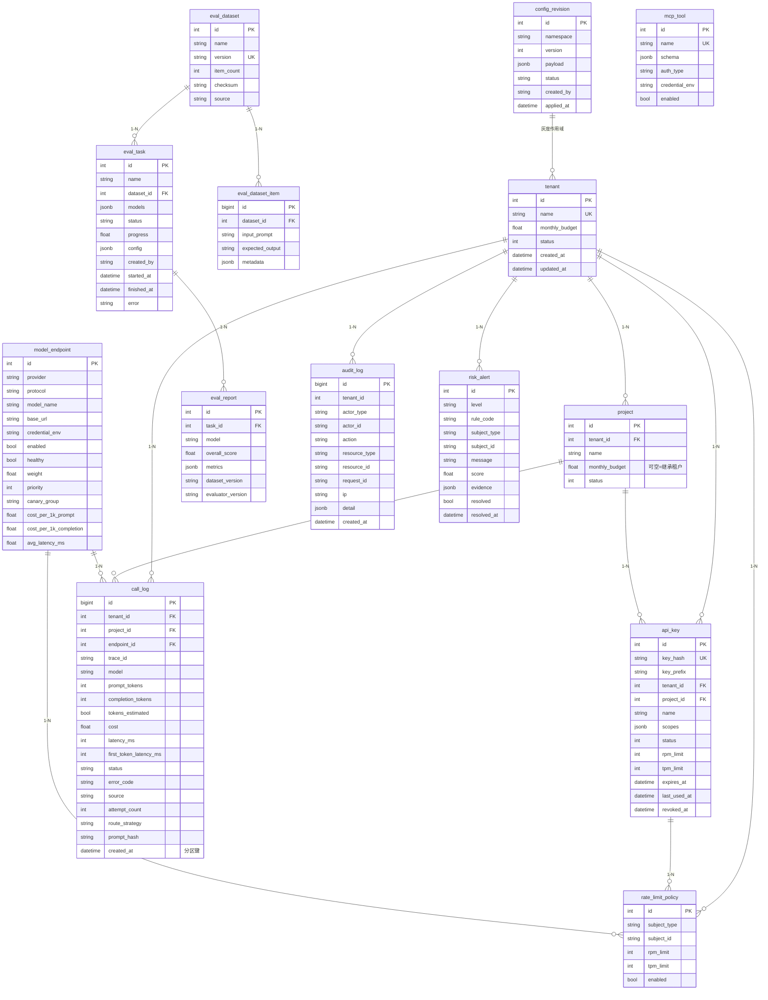
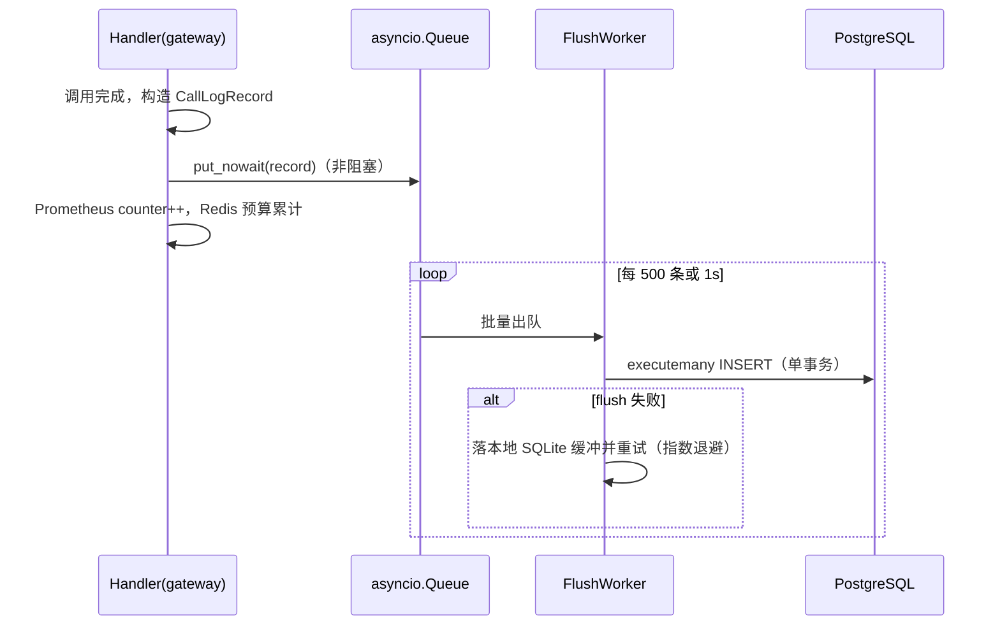
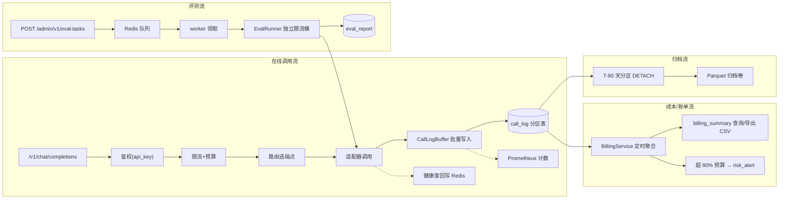

# 数据模型设计 — 大模型统一接入与能力评估中台

| 项 | 内容 |
| --- | --- |
| 文档版本 | v1.0 |
| 存储 | PostgreSQL 16（主库） + Redis 7（限流/缓存/队列，非持久业务数据） |
| 迁移基线 | `migrations/versions/0001_initial.py`（六表）→ `0002_platform_v2.py`（本设计修订+新表+分区） |
| ORM | SQLAlchemy 2.0 `Mapped` 声明式（`src/llm_platform/models/`） |

---

## 1. ER 图



---

## 2. 表结构（字段级）

> 约定：`created_at/updated_at` 由 `TimestampMixin` 统一注入（`DateTime(timezone=True)`，`server_default=now()`）；金额单位 USD，`Float` 存储（展示层保留 4 位小数）；布尔用 `Boolean`；状态枚举用 `String` + 应用层常量（避免 PG 枚举迁移摩擦）。

### 2.1 tenant（修订：无字段删除，保持兼容）
| 字段 | 类型 | 约束 | 说明 |
| --- | --- | --- | --- |
| id | Integer | PK, autoincrement | |
| name | String(128) | UNIQUE, NOT NULL, index | 租户名 |
| monthly_budget | Float | NOT NULL, default 1000.0 | 月度预算（USD），超支熔断 |
| status | Integer | NOT NULL, default 1 | 1=启用 0=停用 |
| created_at / updated_at | DateTime(tz) | NOT NULL | |

### 2.2 project（新增 — 租户/项目/Key 三级隔离）
| 字段 | 类型 | 约束 | 说明 |
| --- | --- | --- | --- |
| id | Integer | PK | |
| tenant_id | Integer | FK→tenant.id, index, NOT NULL | |
| name | String(128) | NOT NULL, UNIQUE(tenant_id, name) | 项目名 |
| monthly_budget | Float | NULL | 空=继承租户预算 |
| status | Integer | default 1 | |

### 2.3 api_key（修订：补项目、scopes、额度、生命周期）
| 字段 | 类型 | 约束 | 说明 |
| --- | --- | --- | --- |
| id | Integer | PK | |
| key_hash | String(64) | UNIQUE, index, NOT NULL | SHA-256(hex) of 明文 Key |
| key_prefix | String(16) | NOT NULL | 明文前 8 位，仅供展示识别 |
| tenant_id | Integer | FK, index, NOT NULL | |
| project_id | Integer | FK→project.id, index, NOT NULL | 三级隔离关键字段 |
| name | String(128) | default "default" | |
| scopes | JSON | default `["chat"]` | 权限范围：`chat`/`embeddings`/`eval`/`admin` |
| status | Integer | default 1 | 1=启用 0=吊销 |
| rpm_limit | Integer | default 60 | 每分钟请求数 |
| tpm_limit | Integer | default 60000 | 每分钟 Token 数 |
| expires_at | DateTime(tz) | NULL | 过期即 401 |
| last_used_at | DateTime(tz) | NULL | 鉴权成功时异步刷新 |
| revoked_at | DateTime(tz) | NULL | |

### 2.4 model_endpoint（修订：协议、凭据引用、灰度分组）
| 字段 | 类型 | 约束 | 说明 |
| --- | --- | --- | --- |
| id | Integer | PK | |
| provider | String(32) | index, NOT NULL | openai/anthropic/deepseek/qwen/ollama/vllm |
| protocol | String(16) | NOT NULL | `openai`/`anthropic`/`ollama`（决定适配器） |
| model_name | String(128) | index, NOT NULL | 对外模型名（/v1/models 返回） |
| base_url | String(512) | NOT NULL | |
| credential_env | String(64) | NOT NULL | 厂商密钥所在环境变量名（**不存密钥本体**） |
| enabled | Boolean | default true | |
| healthy | Boolean | default true | 静态健康位；实时健康度在 Redis |
| weight | Float | default 1.0 | 加权轮询权重 |
| priority | Integer | default 100 | failover 顺序（小者优先） |
| canary_group | String(16) | default "stable" | `stable`/`canary`（灰度发布） |
| cost_per_1k_prompt | Float | default 0.0 | 成本路由/计价用 |
| cost_per_1k_completion | Float | default 0.0 | |
| avg_latency_ms | Float | default 0.0 | EWMA 维护，延迟路由用 |

### 2.5 call_log（修订：项目维度、流式指标、估算标记；按月分区）
| 字段 | 类型 | 约束 | 说明 |
| --- | --- | --- | --- |
| id | BigInteger | PK（分区表用 `id + created_at` 复合主键） | |
| tenant_id | Integer | FK, NOT NULL | |
| project_id | Integer | FK, NOT NULL | |
| endpoint_id | Integer | FK, NULL | 实际命中的端点 |
| trace_id | String(64) | index, NOT NULL | 全链路追踪 ID（= request_id） |
| model | String(128) | NOT NULL | 请求的模型名 |
| prompt_tokens | Integer | default 0 | |
| completion_tokens | Integer | default 0 | |
| tokens_estimated | Boolean | default false | 厂商未返 usage 时为 true |
| cost | Float | default 0.0 | 按 endpoint 单价计算 |
| latency_ms | Integer | default 0 | 端到端 |
| first_token_latency_ms | Integer | NULL | 流式首 token，非流式为 NULL |
| status | String(16) | default "ok" | ok / error / timeout / rate_limited |
| error_code | String(32) | NULL | 对应错误码表 |
| source | String(32) | default "api" | api / eval / mcp |
| attempt_count | Integer | default 1 | 含 failover 重试次数 |
| route_strategy | String(32) | NULL | cost_first / latency_first / weighted / health |
| prompt_hash | String(64) | NULL | Prompt 内容 SHA-256（脱敏溯源，不存明文） |
| created_at | DateTime(tz) | NOT NULL, **分区键** | |

### 2.6 rate_limit_policy（新增 — 限流策略可配）
| 字段 | 类型 | 约束 | 说明 |
| --- | --- | --- | --- |
| id | Integer | PK | |
| subject_type | String(16) | NOT NULL | tenant / api_key / model |
| subject_id | String(64) | NOT NULL, index | 对应主体 ID |
| rpm_limit | Integer | NOT NULL | |
| tpm_limit | Integer | NOT NULL | |
| enabled | Boolean | default true | |

### 2.7 eval_dataset / eval_dataset_item（新增 — 基准集版本化）
**eval_dataset**
| 字段 | 类型 | 约束 | 说明 |
| --- | --- | --- | --- |
| id | Integer | PK | |
| name | String(128) | NOT NULL, index | |
| version | String(32) | UNIQUE, NOT NULL | 语义化版本 |
| item_count | Integer | default 0 | |
| checksum | String(64) | NOT NULL | 内容指纹，防篡改 |
| source | String(256) | default "" | 内置/上传来源 |

**eval_dataset_item**
| 字段 | 类型 | 约束 | 说明 |
| --- | --- | --- | --- |
| id | BigInteger | PK | |
| dataset_id | Integer | FK, index | |
| input_prompt | Text | NOT NULL | |
| expected_output | Text | default "" | 参考答案（可空） |
| metadata | JSON | default {} | 维度标签等 |

### 2.8 eval_task（重构原 eval_task） / eval_report（新增）
**eval_task**（任务级状态机）
| 字段 | 类型 | 约束 | 说明 |
| --- | --- | --- | --- |
| id | Integer | PK | |
| name | String(128) | NOT NULL | |
| dataset_id | Integer | FK, index | |
| models | JSON | NOT NULL | 待评模型列表 `["gpt-4o-mini","deepseek-chat"]` |
| status | String(16) | default "pending" | pending/running/success/failed/cancelled |
| progress | Float | default 0.0 | 0~1 |
| config | JSON | default {} | 并发数、指标集、温度等 |
| created_by | String(64) | NOT NULL | |
| started_at / finished_at | DateTime(tz) | NULL | |
| error | Text | NULL | |

**eval_report**（每模型一行，聚合指标）
| 字段 | 类型 | 约束 | 说明 |
| --- | --- | --- | --- |
| id | Integer | PK | |
| task_id | Integer | FK, index | |
| model | String(128) | NOT NULL, index | |
| overall_score | Float | default 0.0 | 加权总分 |
| metrics | JSON | NOT NULL | `{accuracy, f1, rouge_l, bertscore, latency_p95, tokens, cost, tool_success_rate}` |
| dataset_version | String(32) | NOT NULL | 可复现锚点 |
| evaluator_version | String(64) | NOT NULL | 指标实现版本 |

> 原 `eval_task.dimension/score/report` 字段由 `eval_report.metrics` 承接；`0002` 迁移将旧数据的 `report` JSON 迁入 `eval_report` 后删除旧列。

### 2.9 audit_log（新增 — 操作审计）
| 字段 | 类型 | 约束 | 说明 |
| --- | --- | --- | --- |
| id | BigInteger | PK | |
| tenant_id | Integer | index, NULL | 系统级操作可空 |
| actor_type | String(16) | NOT NULL | api_key / jwt_user / system |
| actor_id | String(64) | NOT NULL | |
| action | String(64) | NOT NULL, index | `tenant.create` / `key.revoke` / `config.update` … |
| resource_type | String(32) | NULL | |
| resource_id | String(64) | NULL | |
| request_id | String(64) | index | 关联 call_log.trace_id |
| ip | String(45) | NULL | |
| detail | JSON | default {} | 脱敏后的变更摘要 |
| created_at | DateTime(tz) | NOT NULL, index | 留存 ≥90 天可配置 |

### 2.10 risk_alert（沿用 0001，无结构变更）
字段见 `entities.py`：level / rule_code / subject_type / subject_id / message / score / evidence / resolved / resolved_at。

### 2.11 config_revision（新增 — 配置版本与灰度）
| 字段 | 类型 | 约束 | 说明 |
| --- | --- | --- | --- |
| id | Integer | PK | |
| namespace | String(32) | NOT NULL, index | routing / limit / canary / alert |
| version | Integer | NOT NULL, UNIQUE(namespace, version) | 单调递增 |
| payload | JSON | NOT NULL | 该命名空间完整配置快照 |
| status | String(16) | default "pending" | pending/applied/rolled_back |
| created_by | String(64) | NOT NULL | |
| applied_at | DateTime(tz) | NULL | |

### 2.12 mcp_tool（新增 — P1-05）
| 字段 | 类型 | 约束 | 说明 |
| --- | --- | --- | --- |
| id | Integer | PK | |
| name | String(128) | UNIQUE, NOT NULL | 工具名 |
| schema | JSON | NOT NULL | JSON Schema（入参/出参） |
| auth_type | String(16) | default "none" | none / bearer / api_key |
| credential_env | String(64) | NULL | 同 endpoint，密钥只存环境变量名 |
| enabled | Boolean | default true | |

---

## 3. 索引与分区策略（百万级 call_log）

### 3.1 call_log 分区
```sql
-- 0002 迁移核心动作：将 call_log 转为按月 RANGE 分区
CREATE TABLE call_log (
    ... ,
    created_at timestamptz NOT NULL
) PARTITION BY RANGE (created_at);

CREATE TABLE call_log_2026_01 PARTITION OF call_log
    FOR VALUES FROM ('2026-01-01') TO ('2026-02-01');
-- …预建至 2026-12；worker 每月 25 日自动建下月分区
```
- **分区键唯一**：`PRIMARY KEY (id, created_at)`。
- **分区裁剪**：所有查询强制带 `created_at` 范围（管理 API 时间过滤默认近 7 天）。

### 3.2 索引清单
| 表 | 索引 | 用途 |
| --- | --- | --- |
| call_log | `(tenant_id, created_at DESC)` | 租户账单/调用查询 |
| call_log | `(project_id, created_at DESC)` | 项目维度查询 |
| call_log | `(trace_id)` | 全链路串联 |
| call_log | `(model, created_at DESC)` | 模型维度统计 |
| call_log | `(endpoint_id, created_at DESC)` | 端点健康统计 |
| call_log | `(status, created_at DESC)` WHERE status<>'ok' | 故障排查（部分索引） |
| api_key | `(key_hash)` UNIQUE | 鉴权 O(1) |
| audit_log | `(created_at DESC)`、`(request_id)`、`(tenant_id, created_at DESC)` | 审计检索 |
| eval_report | `(task_id, model)` | 报告查询 |
| tenant/model_endpoint | name/provider/model_name | 列表过滤 |

### 3.3 写入路径（异步批量）

- 队列容量上限 10000，溢出时丢弃并计 `calllog_dropped_total` 告警（保主链路）。
- 进程收到 SIGTERM 时 drain 队列（最多 5s）。

### 3.4 数据生命周期与归档
| 阶段 | 策略 |
| --- | --- |
| 热数据 | 当月及上月分区（查询 P95 ≤ 3s） |
| 温数据 | T-90 天前分区由 worker `DETACH` 并导出 Parquet 到归档卷 |
| 冷数据 | 导出后 `DROP` 分区；归档卷可挂对象存储扩展 |
| audit_log | 按 `created_at` 月度归档，留存天数可配（默认 90 天，P2-05） |
| Redis | 限流/健康度 key 自然 TTL；`akcache` 吊销时主动 DEL |

---

## 4. Redis 数据布局（非持久业务数据）

| Key 模式 | 类型 | TTL | 用途 |
| --- | --- | --- | --- |
| `rl:{tenant\|key\|model}:{window}` | hash/counter | 窗口长度 | 令牌桶计数（Lua 原子扣减） |
| `budget:{tenant_id}:{YYYYMM}` | float | 40 天 | 月度成本累计 |
| `health:{endpoint_id}` | hash | 30s | 错误率/延迟 EWMA |
| `cb:{endpoint_id}` | string | 30s | 熔断器状态（closed/open/half_open） |
| `akcache:{key_hash}` | string(json) | 60s | 鉴权结果缓存（key_id, tenant_id, project_id, scopes, status） |
| `cfg:{namespace}` + `cfg:ver` | string(json)/int | 60s / 永久 | 配置缓存与版本号 |
| `q:eval` | list | — | 评测任务队列（LPUSH/BRPOP） |
| `canary:{subject_type}:{subject_id}` | int | 60s | 灰度权重快照（配置中心广播） |

---

## 5. 数据流与生命周期（端到端）



**生命周期要点**：
1. **写入**：在线与评测调用最终都落 `call_log`（`source` 区分），计量口径一致。
2. **查询**：管理 API 强制租户过滤 + 时间范围（分区裁剪）；`trace_id` 点查走专用索引。
3. **聚合**：账单按 `tenant/project/model/day` 聚合，由 worker 定时物化到查询结果（不建额外汇总表，作品集规模直接聚合 + 缓存 60s）。
4. **删除**：业务表不物理删除；`api_key` 吊销为软删（status=0）；`call_log` 只随分区归档消失。

---

## 6. 与 API 的映射（节选）

| API | 读/写 | 主表 | 关键字段映射 |
| --- | --- | --- | --- |
| `POST /v1/chat/completions` | W | call_log, api_key(last_used_at) | `usage→prompt/completion_tokens`；`response.id→provider_request_id`；`trace_id→X-Request-Id` |
| `GET /v1/models` | R | model_endpoint | `model_name→id`；`canary_group→owned_by` |
| `POST /admin/v1/tenants` | W | tenant | `monthly_budget` 直映射 |
| `POST /admin/v1/tenants/{id}/api-keys` | W | api_key | 明文仅响应一次；库中只写 `key_hash` |
| `GET /admin/v1/calls` | R | call_log | 过滤：`tenant_id/project_id/model/status/created_at range`；响应含 `trace_id` |
| `POST /admin/v1/eval-tasks` | W | eval_task | `models[]→models JSON`；`dataset_id` 外键 |
| `GET /admin/v1/eval-tasks/{id}/reports` | R | eval_report | `metrics JSON→雷达图数据源` |
| `GET /admin/v1/billing/summary` | R | call_log(聚合) | `sum(cost) group by tenant/project/model` |
| `GET /admin/v1/audit-logs` | R | audit_log | 过滤 `request_id/tenant/actor/action` |
| `PUT /admin/v1/config/{namespace}` | W | config_revision | `payload` 全量快照 + `version+1` |

---

## 7. 与 0001 迁移的兼容性说明

| 动作 | 对象 | 说明 |
| --- | --- | --- |
| 新增表 | project / rate_limit_policy / eval_dataset / eval_dataset_item / eval_report / audit_log / config_revision / mcp_tool | `0002` 一次建齐 |
| 加列 | api_key(+4)、model_endpoint(+3)、call_log(+5) | 全部带 default，可在线执行 |
| 重构 | eval_task 抽出 eval_report | 旧 `report` 数据迁移后删列 |
| 转分区 | call_log | `0002` 内建新分区表 + 数据搬迁 + 重命名（停机窗口小，作品集可接受） |
| 回滚 | `downgrade()` | 删新表/新列、分区表合并回普通表 |
