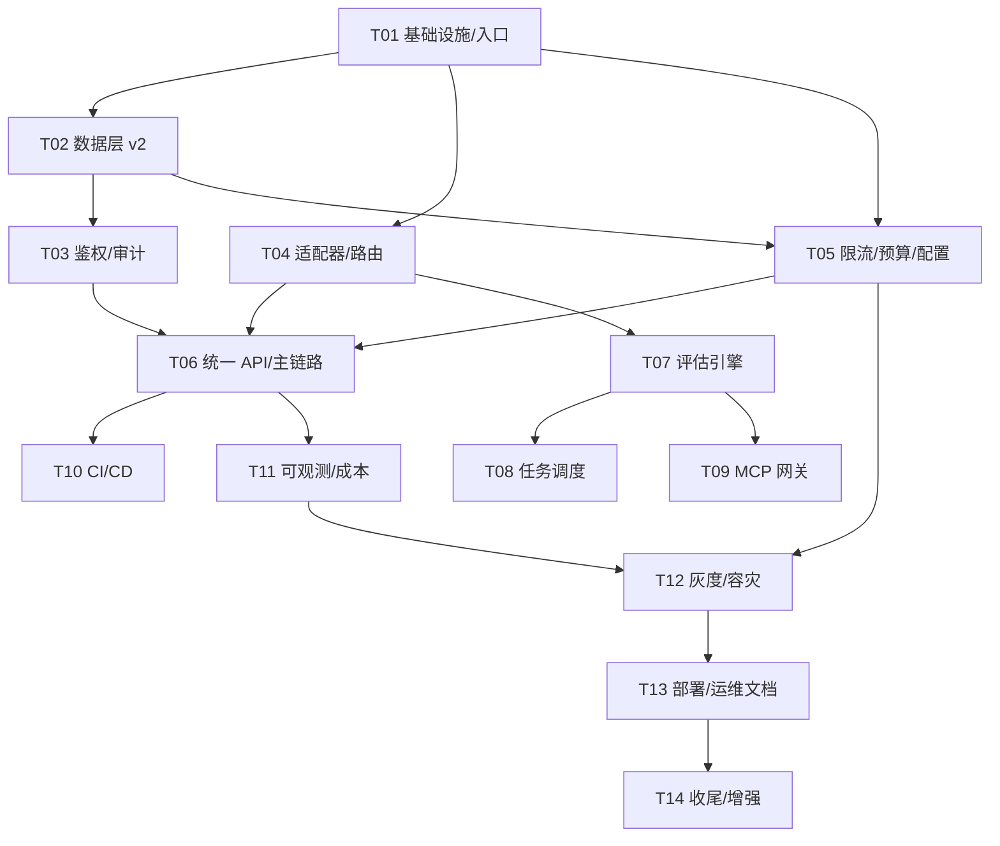

# 分阶段实施计划 — 大模型统一接入与能力评估中台

| 项 | 内容 |
| --- | --- |
| 文档版本 | v1.0 |
| 需求真源 | `docs/PRD.md`（需求编号 P0-01~P0-08 / P1-01~P1-11 / P2-01~P2-06） |
| 配套设计 | `docs/architecture.md`（ADR-001~010）、`docs/api-contract.md`、`docs/data-model.md` |
| 里程碑 | 4 个（基础接入 → 能力评估 → 工程化 → 文档运维） |
| 任务总数 | 14（T01~T14，按依赖有序） |

> **文件标注约定**：`[复用]` 既有文件直接使用；`[重构]` 既有文件修改；`[新增]` 新建文件。相对路径以仓库根为基准。

---

## 1. 里程碑总览

| 里程碑 | 范围 | 任务 | 关键 DoD |
| --- | --- | --- | --- |
| **M1 基础框架与统一模型接入** | P0-01~P0-08 | T01~T06 | OpenAI SDK 调用 4 家模型，带鉴权/限流/落库/日志，端到端可演示 |
| **M2 能力评估体系** | P1-01~P1-06 | T07~T09 | 一键批量评测 ≥2 模型并产出可复现对比报告 |
| **M3 工程化能力** | P1-07~P1-11 | T10~T12 | CI 全绿、Grafana 看板可用、灰度与故障切换演练通过 |
| **M4 文档、部署与运维** | P2-01~P2-06 | T13~T14 | 新机器 30 分钟部署跑通；运维 SOP 覆盖 ≥5 场景 |

---

## 2. 里程碑详情

### M1 基础框架与统一模型接入（P0-01~P0-08）

**目标**：打通"认证 → 限流 → 路由 → 多厂商适配 → 异步落库 → 日志追踪"主链路，OpenAI SDK 零改造可接入。

**交付物**：
1. FastAPI 应用入口 + 中间件（trace_id/脱敏/计时）
2. 数据层 v2 迁移（project、api_key 扩列、call_log 分区、audit_log 等）
3. JWT + API Key 双轨鉴权（fail-closed）+ 审计
4. Redis 三级令牌桶 + 月度预算熔断
5. 4 个适配器（OpenAI/DeepSeek/Qwen/Ollama）+ 路由策略 + 熔断 failover
6. `/v1/chat/completions`（SSE+非流式）、`/v1/models`、`/v1/embeddings`
7. call_log 异步批量写入 + 结构化日志

**验收标准**（对应 PRD）：
- P0-01：OpenAI SDK 直连跑通 ≥3 厂商；流式边收边发；网关 P95 开销 ≤50ms
- P0-02：无效/过期/吊销 Key 401；明文仅创建时展示；跨租户不可见
- P0-03：限流误差 ≤5%；超预算 429 + 告警；熔断 30s 半开自动恢复
- P0-04：≥4 适配器集成测试通过；厂商差异不外泄到核心
- P0-05：路由策略热更新；故障端点自动剔除；failover P95 ≤200ms
- P0-06：`.env.example` 齐全；gitleaks 零告警；配置 5s 生效
- P0-07：迁移可重复执行/回滚；call_log 百万级异步批量写入
- P0-08：request_id 串起全链路；日志无明文 Key/Prompt

**依赖前置**：无（脚手架 22 文件已就位）
**风险**：流式 usage 缺失（Ollama）→ tokenizer 估算 + `estimated` 标记；call_log 分区迁移复杂 → 0002 迁移提供完整 downgrade。

### M2 能力评估体系（P1-01~P1-06）

**目标**：固定基准集批量评测多模型，产出客观指标与可复现对比报告；MCP 工具调用纳入评测。

**交付物**：
1. eval 包（datasets/metrics/runner/report）
2. scheduler 包（队列/状态机/worker）
3. MCP 工具网关 + mcp_tool 表
4. 评测管理 API（数据集/任务/报告/对比/导出）

**验收标准**：
- P1-01：≥5 个客观指标（accuracy/F1、ROUGE、BERTScore、延迟、Token 成本、工具成功率），结果可重算
- P1-02：基准集 ≥200 条且版本化；重复跑分波动 ≤2%
- P1-03：单模型报告 + 多模型雷达图对比，可导出 JSON/PNG
- P1-04：≥2 模型/版本对比，差异归因到指标维度
- P1-05：≥2 个示例 MCP 工具；调用成功率/延迟写入 call_log
- P1-06：评测异步不阻塞主链路；状态可查询；失败可重试

**依赖前置**：M1（复用 adapters 与独立限流桶）
**风险**：BERTScore 依赖 torch 过重 → 作 optional extra，缺失时降级为 ROUGE+人工抽样；评测并发抢占在线流量 → 独立 `eval:` 桶强制隔离。

### M3 工程化能力（P1-07~P1-11）

**目标**：CI/CD、可观测、灰度、存储缓存优化、异常容灾，达到"可直接作为团队级基础设施"。

**交付物**：
1. GitHub Actions 流水线（lint/mypy/单测/集成/gitleaks/镜像构建）
2. Prometheus 指标 + 3 张 Grafana 看板 + 告警规则
3. 配置中心热更新 + 按租户/Key/模型灰度 + 一键回滚
4. 重试退避/超时控制/降级兜底（Ollama）完善 + 故障演练脚本

**验收标准**：
- P1-07：PR 全绿方可合并；镜像自动构建打 tag
- P1-08：看板覆盖流量延迟/错误熔断/Token 成本；告警覆盖 5xx、P95、预算 80%
- P1-09：灰度规则 5s 生效；回滚 ≤1 分钟
- P1-10：百万级 call_log 查询 P95 ≤3s（分区+索引验证）
- P1-11：错误码表文档化；单厂商故障 30s 内切换；无裸 500

**依赖前置**：M1、M2
**风险**：分区查询回归 → 集成测试含百万行造数脚本；灰度配置冲突 → config_revision 全量快照避免增量合并歧义。

### M4 文档、部署与运维（P2-01~P2-06）

**目标**：文档、一键部署、运维手册、密钥轮换与增强项收尾。

**交付物**：
1. README（≤3 条命令启动）+ 部署手册 + 运维手册（≥5 故障 SOP）
2. Docker Compose 一键部署 + 备份/恢复脚本
3. OpenAPI 文档自动生成 + CI 同步校验
4. 密钥轮换策略 + 审计留存配置（≥90 天）
5. P2 增强（多模态/函数调用/Prompt 模板，视余量）

**验收标准**：全新机器 30 分钟跑通；运维 SOP ≥5 场景；文档与代码同步。
**依赖前置**：M3
**风险**：无（收尾阶段）；增强项按余量裁剪，不阻塞 DoD。

---

## 3. 有序任务列表（实现顺序 T01 → T14）

### T01 项目基础设施与应用入口
**里程碑**：M1 ｜ **优先级**：P0 ｜ **依赖**：无 ｜ **对应需求**：P0-06, P0-08
**文件清单**：
| 路径 | 类型 |
| --- | --- |
| `pyproject.toml` | [重构] 补依赖（argon2-cffi、tiktoken、redis lua 相关） |
| `.env.example` | [重构] 补 `LLM_DEEPSEEK_API_KEY/LLM_QWEN_API_KEY/LLM_REDIS_URL` 等占位符 |
| `src/llm_platform/main.py` | [新增] FastAPI app 装配、路由挂载、异常 handler、生命周期 |
| `src/llm_platform/deps.py` | [新增] get_db/get_redis/get_settings/get_current_auth 依赖注入 |
| `src/llm_platform/api/__init__.py` | [新增] |
| `src/llm_platform/api/middleware.py` | [新增] trace_id 生成/透传、访问日志、耗时统计 |
| `src/llm_platform/utils/__init__.py`、`utils/ids.py`、`utils/masking.py` | [新增] request_id 生成、敏感字段脱敏 |
| `src/llm_platform/config.py` | [重构] 补 Redis/路由/限流/灰度配置项 |
| `src/llm_platform/logging.py` | [重构] JSON renderer、采样率、脱敏 processor |
| `src/llm_platform/errors.py` | [重构] 扩展 RATE_008/CONFLICT_009/CONFIG_010 |
| `src/llm_platform/monitoring/__init__.py`、`monitoring/metrics.py` | [新增] Prometheus 指标骨架（被中间件/网关引用） |

**实现顺序要点**：先 `utils/logging/errors`（无依赖）→ `config` → `middleware/deps` → `main` 可启动（`/healthz` 可用）。

### T02 数据层 v2 与仓储
**里程碑**：M1 ｜ **优先级**：P0 ｜ **依赖**：T01 ｜ **对应需求**：P0-07
**文件清单**：
| 路径 | 类型 |
| --- | --- |
| `src/llm_platform/models/base.py` | [复用] |
| `src/llm_platform/models/entities.py` | [重构] 补 project/rate_limit_policy/eval_dataset/eval_report/audit_log/config_revision/mcp_tool；api_key/model_endpoint/call_log 加列 |
| `src/llm_platform/models/schemas.py` | [新增] Pydantic DTO（对应 api-contract 全部请求/响应） |
| `src/llm_platform/models/__init__.py` | [重构] 导出新实体 |
| `src/llm_platform/db/session.py` | [重构] 连接池参数、批量插入辅助 |
| `src/llm_platform/db/repositories/__init__.py` | [新增] |
| `src/llm_platform/db/repositories/{tenant_repo,key_repo,endpoint_repo,call_log_repo,eval_repo,audit_repo}.py` | [新增] 仓储层（唯一 SQL 出口） |
| `migrations/versions/0002_platform_v2.py` | [新增] 新表+加列+call_log 转分区+数据迁移，含完整 downgrade |
| `migrations/versions/0001_initial.py` | [复用] 不改动 |

**实现顺序要点**：entities → schemas → repositories → 0002 迁移 → 本地 `alembic upgrade head` + `downgrade` 验证双向可执行。

### T03 权限与审计
**里程碑**：M1 ｜ **优先级**：P0 ｜ **依赖**：T02 ｜ **对应需求**：P0-02, P0-08
**文件清单**：
| 路径 | 类型 |
| --- | --- |
| `src/llm_platform/auth/__init__.py` | [新增] |
| `src/llm_platform/auth/jwt.py` | [新增] JWT 签发/校验、三档角色 |
| `src/llm_platform/auth/api_key.py` | [新增] Key 生成/哈希/校验、明文一次性返回 |
| `src/llm_platform/auth/service.py` | [新增] 统一鉴权编排（fail-closed、akcache） |
| `src/llm_platform/auth/audit.py` | [新增] 审计写入（脱敏 detail） |
| `src/llm_platform/api/admin/auth.py` | [新增] `POST /admin/v1/auth/token` |
| `src/llm_platform/api/admin/tenants.py`、`api/admin/api_keys.py` | [新增] 租户/Key 管理 API |
| `tests/unit/test_auth.py` | [新增] |

### T04 适配层与动态路由（含熔断 failover）
**里程碑**：M1 ｜ **优先级**：P0 ｜ **依赖**：T01 ｜ **对应需求**：P0-04, P0-05
**文件清单**：
| 路径 | 类型 |
| --- | --- |
| `src/llm_platform/adapters/base.py` | [重构] 补 embeddings 抽象、流式 usage 约定 |
| `src/llm_platform/adapters/openai_adapter.py` | [重构] 连接池复用、流式 usage 估算 |
| `src/llm_platform/adapters/anthropic_adapter.py` | [重构] |
| `src/llm_platform/adapters/ollama_adapter.py` | [重构] |
| `src/llm_platform/adapters/deepseek_adapter.py` | [新增] OpenAI 兼容变体 |
| `src/llm_platform/adapters/qwen_adapter.py` | [新增] OpenAI 兼容变体 |
| `src/llm_platform/adapters/registry.py` | [新增] provider→适配器注册表 |
| `src/llm_platform/routing/__init__.py` | [新增] |
| `src/llm_platform/routing/health.py` | [新增] 健康度滑动窗口 + 熔断器三态 |
| `src/llm_platform/routing/strategies.py` | [新增] cost/latency/weighted/health 策略 |
| `src/llm_platform/routing/router.py` | [新增] 选路 + failover 候选排序 |
| `tests/unit/test_routing.py`、`tests/unit/test_adapters.py` | [新增] |

**实现顺序要点**：base 抽象 → 现有 3 适配器重构 → deepseek/qwen → registry → health/熔断 → strategies → router。

### T05 限流、预算与配置热更新基础
**里程碑**：M1 ｜ **优先级**：P0 ｜ **依赖**：T02 ｜ **对应需求**：P0-03, P0-06
**文件清单**：
| 路径 | 类型 |
| --- | --- |
| `src/llm_platform/ratelimit/__init__.py` | [新增] |
| `src/llm_platform/ratelimit/token_bucket.py` | [新增] Redis Lua 三级令牌桶（RPM/TPM） |
| `src/llm_platform/ratelimit/budget.py` | [新增] 月度预算累计/80% 告警/100% 熔断 |
| `src/llm_platform/ratelimit/policy.py` | [新增] rate_limit_policy 读取与默认值 |
| `src/llm_platform/config_center/__init__.py`、`config_center/schema.py`、`config_center/store.py`、`config_center/watcher.py` | [新增] 配置存储/版本/pub-sub 热更新 |
| `tests/unit/test_ratelimit.py` | [新增] |

### T06 统一接入 API 与主链路编排
**里程碑**：M1 ｜ **优先级**：P0 ｜ **依赖**：T03, T04, T05 ｜ **对应需求**：P0-01, P0-07, P0-08
**文件清单**：
| 路径 | 类型 |
| --- | --- |
| `src/llm_platform/gateway/__init__.py` | [新增] |
| `src/llm_platform/gateway/service.py` | [新增] 主链路编排（鉴权→限流→路由→适配→计量） |
| `src/llm_platform/gateway/sse.py` | [新增] SSE 流式转发（边收边发） |
| `src/llm_platform/gateway/buffer.py` | [新增] call_log 异步批量写入队列 |
| `src/llm_platform/api/v1/__init__.py`、`api/v1/chat.py`、`api/v1/models.py`、`api/v1/embeddings.py` | [新增] OpenAI 兼容面 |
| `src/llm_platform/api/admin/endpoints.py`、`api/admin/calls.py` | [新增] 端点管理 + 调用查询 API |
| `tests/integration/test_e2e_chat.py` | [新增] 认证→路由→适配→落库主链路 |

**M1 DoD 检查**：`docker compose up` 后 OpenAI SDK 用 `sk-` Key 调 4 家模型成功；`/admin/v1/calls` 可查 trace_id 全链路；超预算 429；gitleaks 通过。

### T07 评估引擎核心（指标/基准集/报告）
**里程碑**：M2 ｜ **优先级**：P1 ｜ **依赖**：T04 ｜ **对应需求**：P1-01, P1-02, P1-03
**文件清单**：
| 路径 | 类型 |
| --- | --- |
| `src/llm_platform/eval/__init__.py` | [新增] |
| `src/llm_platform/eval/datasets.py` | [新增] 基准集注册/版本/checksum/内置 200 条种子 |
| `src/llm_platform/eval/metrics.py` | [新增] accuracy/F1、ROUGE-L、BERTScore(optional)、延迟、Token、成本 |
| `src/llm_platform/eval/runner.py` | [新增] 批量推理（独立 `eval:` 限流桶） |
| `src/llm_platform/eval/report.py` | [新增] 聚合评分、雷达图数据、JSON/PNG 导出 |
| `src/llm_platform/api/admin/evals.py` | [新增] 数据集/任务/报告/对比 API |
| `tests/unit/test_metrics.py` | [新增] 指标纯函数可重算验证 |

### T08 任务调度（队列/状态机/worker）
**里程碑**：M2 ｜ **优先级**：P1 ｜ **依赖**：T07 ｜ **对应需求**：P1-06
**文件清单**：
| 路径 | 类型 |
| --- | --- |
| `src/llm_platform/scheduler/__init__.py` | [新增] |
| `src/llm_platform/scheduler/state_machine.py` | [新增] pending→running→success/failed/cancelled 迁移校验 |
| `src/llm_platform/scheduler/queue.py` | [新增] Redis 队列 + 失败重试（指数退避） |
| `src/llm_platform/scheduler/worker.py` | [新增] APScheduler worker 入口（独立进程） |
| `tests/integration/test_eval_flow.py` | [新增] 任务提交→执行→报告端到端 |

### T09 MCP 工具网关
**里程碑**：M2 ｜ **优先级**：P1 ｜ **依赖**：T07 ｜ **对应需求**：P1-05
**文件清单**：
| 路径 | 类型 |
| --- | --- |
| `src/llm_platform/eval/mcp_gateway.py` | [新增] mcp-python-sdk 工具注册/调用代理/审计 |
| `src/llm_platform/models/entities.py` | [重构-增量] mcp_tool 表（T02 已建，此处接入） |
| `examples/mcp_tools/echo_tool.py`、`examples/mcp_tools/search_tool.py` | [新增] 2 个示例工具 |
| `tests/unit/test_mcp_gateway.py` | [新增] |

### T10 CI/CD 流水线
**里程碑**：M3 ｜ **优先级**：P1 ｜ **依赖**：T06 ｜ **对应需求**：P1-07
**文件清单**：
| 路径 | 类型 |
| --- | --- |
| `.github/workflows/ci.yml` | [新增] ruff/mypy/pytest/gitleaks/镜像构建 |
| `deploy/Dockerfile` | [新增] 多阶段构建（gateway + worker 同镜像） |
| `pyproject.toml` | [重构-增量] mypy/gitleaks 配置 |
| `tests/`（全量补齐） | [新增] 单测覆盖率 ≥70%（核心 ≥85%） |

### T11 可观测性与成本核算
**里程碑**：M3 ｜ **优先级**：P1 ｜ **依赖**：T06 ｜ **对应需求**：P1-08, P1-10
**文件清单**：
| 路径 | 类型 |
| --- | --- |
| `src/llm_platform/monitoring/metrics.py` | [重构-增量] QPS/延迟/错误/Token/成本/熔断全量指标 |
| `src/llm_platform/monitoring/billing.py` | [新增] 成本聚合/账单查询/CSV 导出 |
| `src/llm_platform/monitoring/alerts.py` | [新增] 规则引擎（5xx/P95/预算 80%）写 risk_alert |
| `src/llm_platform/api/admin/billing.py`、`api/admin/alerts.py` | [新增] 账单/告警 API |
| `deploy/prometheus/prometheus.yml`、`deploy/prometheus/alerts.yml` | [新增] |
| `deploy/grafana/dashboards/{traffic_latency,error_circuit,token_cost}.json` | [新增] 3 张看板 |
| `scripts/seed_call_log.py` | [新增] 百万行造数（验证查询 P95 ≤3s） |

### T12 灰度发布与容灾完善
**里程碑**：M3 ｜ **优先级**：P1 ｜ **依赖**：T05, T11 ｜ **对应需求**：P1-09, P1-11
**文件清单**：
| 路径 | 类型 |
| --- | --- |
| `src/llm_platform/api/admin/config.py` | [新增] 配置/灰度/回滚 API |
| `src/llm_platform/routing/router.py` | [重构-增量] canary 权重分流 |
| `src/llm_platform/gateway/service.py` | [重构-增量] 重试退避/超时控制/Ollama 降级兜底 |
| `scripts/failover_drill.sh`、`scripts/canary_drill.sh` | [新增] 故障切换/灰度回滚演练脚本 |
| `tests/integration/test_failover.py` | [新增] |

### T13 部署、运维与文档交付
**里程碑**：M4 ｜ **优先级**：P2 ｜ **依赖**：T12 ｜ **对应需求**：P2-02, P2-03, P2-04
**文件清单**：
| 路径 | 类型 |
| --- | --- |
| `deploy/docker-compose.yml` | [新增] gateway/worker/postgres/redis/prometheus/grafana/ollama |
| `deploy/backup.sh`、`deploy/restore.sh` | [新增] PG dump + Redis RDB |
| `README.md` | [新增] ≤3 条命令启动 |
| `docs/deployment.md` | [新增] 单机服务器部署手册 |
| `docs/operations.md` | [新增] ≥5 故障 SOP（厂商故障/预算告警/Redis 宕机/PG 分区满/配置回滚） |

### T14 收尾：OpenAPI 校验、密钥轮换与增强
**里程碑**：M4 ｜ **优先级**：P2 ｜ **依赖**：T13 ｜ **对应需求**：P2-01, P2-05, P2-06
**文件清单**：
| 路径 | 类型 |
| --- | --- |
| `scripts/export_openapi.py`、`.github/workflows/ci.yml` | [新增/重构] OpenAPI 导出与 CI 同步校验 |
| `docs/operations.md` | [重构-增量] 密钥轮换策略 + 审计留存配置说明 |
| `src/llm_platform/api/v1/chat.py` | [重构-增量] 多模态/函数调用（视余量，P2-06） |
| `src/llm_platform/config_center/`（prompt 模板） | [重构-增量] Prompt 模板管理（视余量） |

---

## 4. 任务依赖图

**并行建议**：T03 与 T04 可并行（同依赖 T02/T01）；T08 与 T09 可并行；T10 与 T11 可并行。

---

## 5. 依赖包列表

### 5.1 运行时（`pyproject.toml` dependencies）
| 包 | 版本 | 用途 |
| --- | --- | --- |
| fastapi | ≥0.115 | Web 框架 |
| uvicorn[standard] | ≥0.30 | ASGI 服务器 |
| pydantic | ≥2.8 | Schema 校验 |
| pydantic-settings | ≥2.4 | 配置（LLM_ 前缀） |
| sqlalchemy | ≥2.0 | ORM |
| alembic | ≥1.13 | 迁移 |
| psycopg[binary] | ≥3.2 | PostgreSQL 驱动 |
| redis | ≥5.0 | 限流/缓存/队列 |
| httpx | ≥0.27 | 厂商 HTTP 客户端（流式 SSE） |
| structlog | ≥24.1 | 结构化日志 |
| prometheus-client | ≥0.20 | 指标 |
| apscheduler | ≥3.10 | 评测任务调度 |
| pyjwt | ≥2.9 | JWT |
| argon2-cffi | ≥23.1 | 口令类哈希（API Key 主用 SHA-256） |
| tiktoken | ≥0.7 | 流式 usage 估算（tokenizer） |
| mcp | ≥1.0 | MCP 工具网关（P1-05） |
| matplotlib | ≥3.8 | 评测报告 PNG 导出（P1-03） |
| rouge-score | ≥0.1.2 | ROUGE-L 指标（P1-01） |
| bert-score | ≥0.3.13 | BERTScore（**optional extra**，缺 torch 自动降级） |

### 5.2 开发（optional-dependencies.dev）
| 包 | 版本 | 用途 |
| --- | --- | --- |
| pytest | ≥8.2 | 测试框架 |
| pytest-asyncio | ≥0.23 | 异步测试（asyncio_mode=auto） |
| ruff | ≥0.5 | lint + format |
| mypy | ≥1.10 | 类型检查 |
| httpx（test client） | — | FastAPI TestClient 复用 |
| gitleaks | 二进制（CI 步骤） | 密钥扫描合并门槛 |
| freezegun | ≥1.5 | 时间相关单测（预算月度） |

### 5.3 运维/部署
| 组件 | 版本 | 用途 |
| --- | --- | --- |
| postgres | 16-alpine | 主库（分区表） |
| redis | 7-alpine | 限流/缓存/队列 |
| prometheus | latest | 指标采集 |
| grafana | latest | 看板 |
| ollama | latest | 自托管兜底（可选） |
| docker compose | v2 | 一键部署 |

---

## 6. 共享知识（跨文件约定）

1. **错误码**：`<域>_<3位编号>`（AUTH_001/QUOTA_002/ROUTE_003/UPSTREAM_004/VALID_005/NOT_FOUND_006/RISK_007/RATE_008/CONFLICT_009/CONFIG_010 + SYS_000）；对外统一信封 `{"error": {code, message, trace_id, context}}`；新增错误码必须同步 `api-contract.md` §0.2。
2. **日志字段**（结构化 JSON，全模块统一）：`timestamp, level, event, trace_id, tenant_id, project_id, api_key_id, model, provider, latency_ms, status, error_code, source`；敏感字段（prompt/key/email/phone）只记 `*_hash` 与 `*_len`，由 `utils/masking.py` 统一处理，禁止散落手写脱敏。
3. **trace_id**：入口中间件生成 UUIDv4 → `ContextVar`（`logging.set_trace_id`）→ 响应头 `X-Request-Id` → call_log.trace_id → audit_log.request_id。下游厂商请求透传 `X-Request-Id`。
4. **命名规范**：包/模块小写下划线；类 PascalCase；函数/变量 snake_case；错误码大写；常量大写；配置键 `LLM_` 前缀大写下划线。
5. **配置键**：全部经 `Settings`（pydantic-settings，`LLM_` 前缀）读取；密钥类只读环境变量（`credential_env` 机制），禁止默认值含真值；`.env.example` 只放占位符。
6. **API 约定**：业务面返回 OpenAI 形状（扩展字段 `x_` 前缀）；管理面成功返回资源 JSON，错误返回统一信封；分页 `page/page_size/sort`；时间为 ISO 8601 UTC。
7. **数据约定**：金额 USD（Float，展示 4 位）；token 计数 Integer；`tokens_estimated` 标识估算；状态枚举用 String 常量（定义于 `models/schemas.py`），禁止魔法值散落。
8. **仓储唯一出口**：所有 SQL 只出现在 `db/repositories/*`；业务层禁止裸写 session.query。
9. **限流桶前缀**：在线 `rl:`/`budget:`；评测 `eval:rl:`；不得混用（ADR-003）。
10. **测试约定**：`tests/unit`（纯函数/服务）与 `tests/integration`（主链路/迁移）分离；asyncio_mode=auto；核心模块覆盖率 ≥85%。
11. **红线重申**：密钥零硬编码（gitleaks 合并门槛）；鉴权 fail-closed；日志脱敏；`monitoring` 不反向控制业务链路。

---

## 7. 待明确事项

| # | 事项 | 影响 | 默认方案（未回复即按此执行） |
| --- | --- | --- | --- |
| 1 | 厂商适配器优先接入顺序 | M1 排期 | OpenAI + DeepSeek + Qwen + Ollama 先行，Anthropic 紧随（PRD §7-1） |
| 2 | 主观评测维度（人工打分/偏好）是否进 P1 | 评估引擎工作量 | P1 只做客观指标，主观维度放 P2（PRD §7-2） |
| 3 | 是否对接企业 SSO / 细粒度 RBAC | auth 复杂度 | JWT 三档角色，SSO 留扩展点（PRD §7-3） |
| 4 | 账单导出是否对接外部财务系统 | monitoring 边界 | 自核算 + CSV/JSON 导出，不对接外部（PRD §7-4） |
| 5 | 流式 usage 估算口径（Ollama 等不返 usage） | Token 计量误差 ≤1% 目标 | tiktoken 近似估算 + `tokens_estimated=true`；误差超标再引入厂商 tokenizer |
| 6 | 评测 PNG 报告渲染方式 | P1-03 依赖 | 服务端 matplotlib 渲染；前端交互图表留 P2 |
| 7 | call_log 归档介质 | 运维成本 | 本地卷 + Parquet 导出脚本；对象存储留扩展点 |
| 8 | P2-06 增强（多模态/函数调用/Prompt 模板）取舍 | M4 工期 | 按余量裁剪，不阻塞 M4 DoD |
